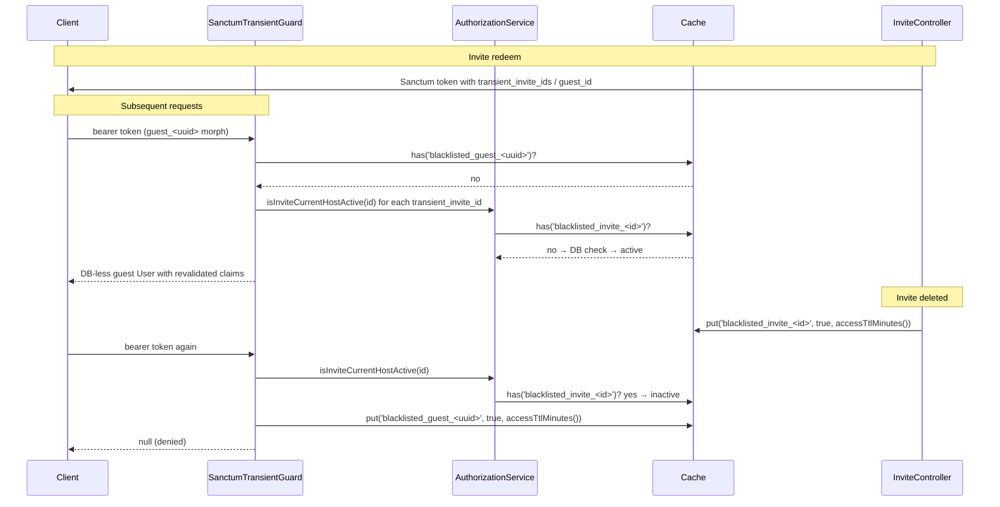

# Guest Token Revocation (Invite Blacklist)

## Problem

A guest credential redeemed through `InviteController::redeem()` must stop
working as soon as the invite is revoked. Otherwise a deleted invite leaves a
window in which the former guest can still reach the galleries it granted.
The guest token is a Sanctum token (Portal #9, D-73); its access-token window is
240 minutes (`auth.migration.access_ttl`).

## Solution: Cache-based Invite-ID Blacklist

Revocation uses the existing cache-backed blacklist rather than a new table.
A deleted invite writes a `blacklisted_invite_<id>` marker; every guest
resolution checks the invite IDs carried by the token against live invite state
and refuses the guest if none is still active on the current host.

### Architecture

### Key Components

1. **`InviteController::redeem()`** (`backend/app/Http/Controllers/InviteController.php`)
   - Issues a Sanctum token whose `TransientClaims` carry `guestId`,
     `transientInviteIds` and `transientGalleries`, linking the credential to the
     `GalleryInvite` records. Roles are never copied into abilities (D-78).

2. **`InviteController::destroy()`** (`backend/app/Http/Controllers/InviteController.php`)
   - After deleting the `GalleryInvite`, writes `blacklisted_invite_<id>` to the
     cache with a TTL of `auth.migration.access_ttl` (240 min). This is a cache
     fast-path only: `AuthorizationService::isInviteActive()` also checks the
     database after the marker expires, so revocation is not solely bounded by
     the TTL.

3. **`SanctumTransientGuard::hydrateGuest()`** (`backend/app/Auth/SanctumTransientGuard.php`)
   - Checks the per-token marker `blacklisted_guest_<uuid>` first, then filters
     the token's transient invite IDs through
     `AuthorizationService::isInviteCurrentHostActive()`. When none is active it
     writes the per-token marker (cache fast-path) and returns no guest — every
     transient claim is revalidated on every request (D-39/D-44). The guard
     replaced the deleted `TransientUserProvider` in Portal #9 Phase 4 (D-77).

### Cache TTL Strategy

| Cache Key Pattern | TTL | Rationale |
|---|---|---|
| `blacklisted_guest_<uuid>` | 240 min (`auth.migration.access_ttl`) | Matches the access-token lifetime; auto-cleaned |
| `blacklisted_invite_<id>` | 240 min (`auth.migration.access_ttl`) | Fast-path; the DB lookup after expiry keeps revocation permanent |

Both markers self-expire; revocation remains effective because the database is
authoritative once a marker is gone.

### Open Items

- **Per-gallery granularity:** a guest who accumulated galleries from multiple
  invites loses all of them when one invite is deleted (the whole credential is
  refused). Acceptable for the single-invite guest use case.
- **Real-user tokens:** guests who later register keep their galleries through
  their real user token. The guest morph (`guest_<uuid>`) applies only to
  DB-less guest identities.
